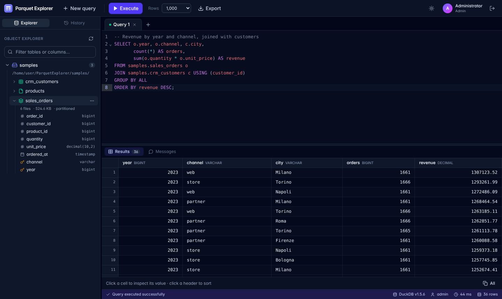

# Parquet Explorer

Un "SQL Server Management Studio" per file **Parquet**: un'applicazione web (solo browser, con login) che
espone ogni cartella di file parquet come una **tabella SQL**, su **cartelle locali** o su **S3**
(AWS, MinIO, Cloudflare R2, Ceph…).



- **C# / .NET 10 + Blazor Server**: tutta la logica gira sul server, il browser riceve solo l'interfaccia.
- **DuckDB** in-process come motore SQL: colonnare, vettoriale, multi-thread, legge parquet in streaming
  con projection/filter pushdown e partition pruning. Niente import, niente database da gestire.
- **Tailwind CSS v4** per il design (tema scuro/chiaro) e **CodeMirror 6** come editor SQL.

## Funzionalità

| Area | Cosa fa |
| --- | --- |
| Object Explorer | Albero sorgenti → tabelle → colonne (tipo, chiavi di partizione), filtro per nome tabella/colonna, refresh per sorgente |
| Cartelle = tabelle | `sorgente.cartella_sottocartella`; partizioni Hive (`year=2024/month=01`) unite nella tabella padre e disponibili come colonne; i file parquet nella root diventano tabelle singole |
| Editor SQL | Tab multipli, evidenziazione, autocompletamento su schemi/tabelle/colonne, **F5 / Ctrl+Enter**, esegue solo la **selezione** se presente (come SSMS), tab salvati nel browser |
| Risultati | Griglia virtualizzata (100k righe fluide), più result set per script, ordinamento per colonna, ispezione/copia celle, copia TSV per Excel, pannello Messages con errori e tempi |
| Script rapidi | Click destro su una tabella: *Select top 1000*, *Count*, *Describe*, *Summarize* (statistiche colonne), *File & row group*, *Script as SELECT* |
| Export | Risultato completo (senza limite di righe) in **CSV**, **Parquet** (zstd) o **JSON lines**, in streaming |
| Esecuzione | Barra di avanzamento reale, **Cancel** immediato, timeout configurabile, query parallele tra utenti |
| Cronologia | Storico query per utente, riapribile in un nuovo tab |
| Gestione sorgenti | Pagina admin per aggiungere, modificare, testare ed eliminare cartelle locali e bucket S3 **senza riavvio** |
| Gestione utenti | Pagina admin per creare utenti *Viewer* o *Admin*, cambiare ruolo, reimpostare password, disabilitare/eliminare |
| Sicurezza | Login con cookie, password PBKDF2, blocco dopo N tentativi, ruoli `Admin` / `Viewer`, sandbox DuckDB (vedi sotto) |

## Avvio rapido (sviluppo)

```bash
cd src/ParquetExplorer
dotnet run
```

Apri l'URL mostrato (es. `http://localhost:5063`) ed entra con `admin` / `admin`: è l'admin iniziale definito
solo in `appsettings.Development.json`. Gli altri utenti si creano dalla pagina **Users**.

La cartella `samples/` contiene un piccolo dataset dimostrativo (ordini partizionati per anno/canale, clienti, prodotti).

## Amministrazione

Gli utenti con ruolo **Admin** vedono nella barra in alto i link **Sources** e **Users**.

### Data sources (`/admin/sources`)

- **Add source**: nome (diventa lo schema SQL), tipo *Local folder* o *S3 bucket*, percorso oppure
  bucket/prefisso/regione/endpoint/credenziali.
- **Test connection** controlla la sorgente prima di salvarla e mostra quante tabelle esporrà.
- Al salvataggio il motore viene ricostruito **a caldo**: la nuova sorgente compare subito nell'Object Explorer
  di tutti gli utenti, e le query già in esecuzione terminano normalmente.
- Le sorgenti create dalla pagina si possono modificare ed eliminare (i file non vengono mai toccati).
  Quelle definite in `appsettings.json` / variabili d'ambiente compaiono come *configuration* e si cambiano solo lì.
- I segreti S3 sono salvati **cifrati** (ASP.NET Data Protection) e non vengono mai rimandati al browser:
  lasciando vuoto il campo in modifica si mantiene quello salvato.
- Con `SourceManagement:AllowedLocalRoots` puoi limitare le cartelle locali aggiungibili (es. solo sotto `/data`).

### Users (`/admin/users`)

- **Add user**: username, nome visualizzato, password (minimo 8 caratteri) e ruolo:
  - **Viewer**: esplora le sorgenti, esegue query di sola lettura, esporta i risultati;
  - **Admin**: tutto, più qualsiasi istruzione SQL e la gestione di sorgenti e utenti.
- Cambio ruolo, modifica nome, reset password, disabilita/riabilita, elimina.
  Le modifiche valgono **subito**, anche per le sessioni già aperte.
- L'admin iniziale (*built-in*) è definito in configurazione e non è modificabile dalla pagina;
  non puoi disabilitare o eliminare te stesso e resta sempre almeno un admin attivo.

Utenti e sorgenti gestiti dalla UI sono salvati in `StateDirectory` (`users.json`, `sources.json`, `keys/`):
**fai il backup di questa cartella** (in Docker è il volume `/state`). Senza `keys/` i segreti S3 salvati
non sono più leggibili e vanno reinseriti.

## Configurazione

Tutto sta nella sezione `ParquetExplorer` di `appsettings.json` (o variabili d'ambiente,
es. `ParquetExplorer__DataSources__0__Path=/data`).

```jsonc
{
  "ParquetExplorer": {
    "StateDirectory": "App_Data",          // users.json, sources.json e chiavi di cifratura (keys/)
    "CatalogRefreshMinutes": 10,           // ri-scansione automatica delle cartelle (0 = solo manuale)
    "SourceManagement": {
      "AllowedLocalRoots": [ "/data" ]     // cartelle in cui gli admin possono aggiungere sorgenti ([] = ovunque)
    },
    // Sorgenti fisse (opzionali): si possono aggiungere anche dalla pagina Data sources
    "DataSources": [
      { "Name": "local", "Type": "Local", "Path": "/mnt/datalake" },
      {
        "Name": "lake", "Type": "S3",
        "Bucket": "my-bucket", "Prefix": "warehouse/",
        "Region": "eu-west-1",
        "AccessKeyId": "AKIA...", "SecretAccessKey": "..."
        // oppure "UseCredentialChain": true  (env, profilo ~/.aws, IAM role)
      },
      {
        "Name": "minio", "Type": "S3", "Bucket": "lake",
        "Endpoint": "minio:9000", "UrlStyle": "path", "UseSsl": false,
        "AccessKeyId": "minioadmin", "SecretAccessKey": "minioadmin"
      }
    ],
    "Query": {
      "DefaultRowLimit": 1000,             // righe caricate in griglia (l'export non ha limiti)
      "MaxRowLimit": 100000,
      "Threads": 0,                        // 0 = tutti i core
      "MemoryLimit": "8GB",                // vuoto = default DuckDB (80% RAM)
      "TempDirectory": "/var/tmp/px",      // spill su disco per join/sort enormi + export
      "ExtensionDirectory": "",            // dove DuckDB installa httpfs (S3)
      "TimeoutSeconds": 300,
      "EnableObjectCache": true,           // cache dei metadati parquet (e S3) tra query
      "LateMaterialization": false         // ottimizzatore DuckDB lento con molti file (vedi Prestazioni)
    },
    "Auth": {
      "SessionHours": 12,
      "MaxFailedAttempts": 5,
      "LockoutMinutes": 5,
      // Solo l'admin iniziale: gli altri utenti si gestiscono dalla pagina Users
      "Users": [
        { "Username": "admin", "DisplayName": "Administrator", "PasswordHash": "AQAAAA...", "Roles": [ "Admin" ] }
      ]
    }
  }
}
```

Opzioni per sorgente: `UnionByName` (unisce schemi diversi tra file, più lento all'avvio su S3),
`RootFilesAsTables` (default `true`), `Extensions` (default `.parquet`, `.parq`, `.pq`).
Cartelle e file che iniziano con `_` o `.` (`_SUCCESS`, `_temporary`, `_delta_log`, `.crc`…) vengono ignorati.

Altre chiavi: `DataProtectionKeysPath` (default `StateDirectory/keys`).

### Configurare l'admin iniziale

```bash
dotnet run --project src/ParquetExplorer -- hash-password          # chiede la password senza mostrarla
dotnet run --project src/ParquetExplorer -- hash-password 'Segreta!' # oppure come argomento
```

Copia l'hash in `PasswordHash` dell'utente in `Auth:Users` (o nella variabile
`ParquetExplorer__Auth__Users__0__PasswordHash`). Una volta entrato, crea gli altri utenti dalla pagina **Users**.

### Come le cartelle diventano tabelle

```
/mnt/datalake/
├── products.parquet                      → local.products
├── crm/customers/part-0.parquet          → local.crm_customers   (tutti i file della cartella)
└── sales/orders/year=2024/month=01/*.parquet
                                          → local.sales_orders     (+ colonne year, month)
```

Ogni tabella è una vista DuckDB su `read_parquet(...)`: i filtri sulle colonne di partizione
saltano intere cartelle, e solo le colonne usate vengono lette dai file.

## Prestazioni con molti file

Lo scan **non legge i dati**: elenca i file, poi per ogni tabella crea una vista; DuckDB legge solo il
footer di un file per lo schema. Accorgimenti per cartelle con decine di migliaia di file:

- tipi delle colonne di partizione ricavati dai nomi delle cartelle (`hive_types`), senza auto-detect;
- glob con un livello per chiave (`year=*/month=*/*.parquet`) invece di `**`;
- viste create in parallelo, colonne lette dal catalogo DuckDB;
- refresh incrementale: le tabelle i cui file non sono cambiati non vengono ricreate;
- all'avvio ogni sorgente è interrogabile appena pronta, senza aspettare le altre;
- `parquet_metadata_cache` attiva e late materialization disattivata.

Misure su una tabella da **190.000 file** (disco locale):

| | Prima | Ora |
|---|---|---|
| Scan iniziale | 14,6 s | 4,2 s |
| Refresh periodico | 13,8 s | 1,7 s |
| Query su una partizione | 11,4 s | 5,9 s |
| `SELECT * … LIMIT 100` | 29,7 s | 3,9 s |

Il tempo che resta è soprattutto un costo fisso per query: DuckDB rielenca e prepara tutti i file della
tabella a ogni esecuzione, anche quando il filtro tocca una sola partizione. Cresce con il **numero** di file,
non con i GB: compattare in file da 128 MB–1 GB lo riduce in proporzione. Su S3 ogni elenco costa una
richiesta LIST ogni 1.000 file.

## Sicurezza

- Tutte le pagine e le API richiedono il login; cookie `HttpOnly`, `SameSite=Strict`, sessione scorrevole.
- Ruoli e stato degli account sono ricontrollati a ogni query e a ogni richiesta: un utente disabilitato o
  declassato perde i permessi subito.
- Gli utenti senza ruolo `Admin` possono eseguire solo istruzioni di lettura
  (`SELECT`, `WITH`, `FROM`, `DESCRIBE`, `SHOW`, `SUMMARIZE`, `EXPLAIN`, `PIVOT`…).
- **Sandbox DuckDB** (vale anche per gli admin): dopo l'avvio l'accesso al file system è limitato alle
  sorgenti configurate (`allowed_directories` + `enable_external_access = false`) e la configurazione è
  bloccata (`lock_configuration`): da SQL non si possono leggere altri file del server, installare
  estensioni, cambiare impostazioni o leggere le credenziali S3.
- In produzione mettilo dietro HTTPS (reverse proxy: gli header `X-Forwarded-*` sono supportati).

## Docker

```bash
docker build -t parquet-explorer .
docker run -p 8080:8080 \
  -v /percorso/ai/parquet:/data:ro -v px-state:/state \
  -e ParquetExplorer__Auth__Users__0__Username=admin \
  -e ParquetExplorer__Auth__Users__0__PasswordHash='AQAAAA...' \
  -e ParquetExplorer__Auth__Users__0__Roles__0=Admin \
  parquet-explorer
```

L'immagine ha già una sorgente `data` → `/data`, salva utenti/sorgenti/chiavi nel volume `/state`,
permette di aggiungere dalla UI solo cartelle sotto `/data` e pre-installa l'estensione DuckDB `httpfs` per S3.
Per esporre altre cartelle montale sotto `/data` (es. `-v /mnt/vendite:/data/vendite:ro`).
`docker-compose.yml` mostra un esempio con cartella locale + MinIO.
Per generare un hash con Docker: `docker run --rm parquet-explorer hash-password 'Segreta!'`.

## Struttura del progetto

```
src/ParquetExplorer/
├── Program.cs                 host, autenticazione, comandi CLI (hash-password, install-extensions)
├── Options/                   modello di configurazione
├── Services/
│   ├── DuckDbEngine.cs        database DuckDB sandboxato, ricostruzione a caldo, credenziali S3
│   ├── SourceRegistry.cs      sorgenti da configurazione + gestite da UI (segreti cifrati)
│   ├── CatalogService.cs      scoperta cartelle → tabelle/viste, partizioni Hive, test connessione
│   ├── QueryService.cs        esecuzione streaming, limite righe, cancel, progress, timeout
│   ├── SqlGuard.cs / SqlText  split degli script e controllo sola lettura
│   ├── UserStore.cs           admin iniziale + utenti gestiti da UI, hash password, lockout
│   └── QueryHistoryService.cs
├── Endpoints/                 /api/export, /auth/logout
├── Components/                pagine Blazor (Login, Workbench, Admin/Sources, Admin/Users) e componenti
└── ClientApp/                 sorgenti front-end: Tailwind (src/app.css) + CodeMirror (src/editor.js)
tests/ParquetExplorer.Tests/   test unitari e d'integrazione (DuckDB reale su file parquet temporanei)
```

### Front-end

CSS e JS compilati sono già in `wwwroot/` (non serve Node per eseguire l'app). Se modifichi le classi
Tailwind nei componenti o l'editor:

```bash
cd src/ParquetExplorer/ClientApp
npm install
npm run build        # oppure: npm run watch:css
```

oppure `dotnet build -p:BuildClientAssets=true`.

### Test

```bash
dotnet test
```
